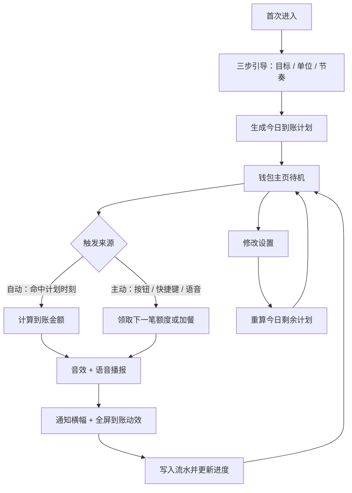

# 工资到账提示器 · 产品需求文档（PRD）

## 1. 产品概述

输入每月目标工资，应用会在一天中的多个随机时刻模拟"收款到账"，用气泡通知、收款音效与语音播报提供情绪价值和工作激励。

- 主打"假装自己已经在收钱"的即时正反馈：金额、单位、节奏均可自定义，既可用真实货币，也可用查克拉、画饼数等虚拟单位隐藏真实收入。
- 形态为 **跨平台 PWA 网页应用**：桌面浏览器/安装为桌面应用、手机浏览器/添加到主屏幕均可使用；后续可用 Capacitor 快速打包成 iOS/Android App。

## 2. 核心功能

### 2.1 用户角色

| 角色 | 注册方式 | 核心权限 |
|------|----------|----------|
| 本机用户 | 无需注册、无需登录 | 使用全部功能，数据仅保存在本地设备（localStorage） |

### 2.2 功能模块

1. **钱包主页**：本月到账、目标进度、今日节奏时间轴、下次到账倒计时、主动"收一笔"、近 7 日到账柱状图、到账流水。
2. **首次引导**：三步完成目标金额、单位、节奏与提示方式配置，可一键使用"示例方案"。
3. **设置面板**：目标与单位、触发节奏、提示方式、主动触发（快捷键/语音）、数据管理、跨平台说明。
4. **到账动效层**：全屏金额滚动 + 光斑动效 + 随机到账语录；同时叠加 iOS 风格通知横幅。
5. **悬浮窗模式（桌面）**：通过 Document Picture-in-Picture 弹出置顶小窗，显示今日金额、倒计时与"收一笔"按钮；不支持时自动隐藏。

### 2.3 页面详情

| 页面名称 | 模块名称 | 功能描述 |
|----------|----------|----------|
| 钱包主页 | 顶部状态栏 | 应用标识、当前节奏状态（自动/手动/免打扰）、设置入口、悬浮窗入口 |
| 钱包主页 | 本月主卡 | 大字号显示本月已到账金额；目标进度条与百分比；今日已到账/今日目标；剩余待领金额；本月剩余天数 |
| 钱包主页 | 今日时间轴 | 以圆点展示今日计划 N 笔到账，已到账点亮、待触发为空心；展示"下一笔 · 倒计时"；可点击展开今日明细 |
| 钱包主页 | 主动收款 | 大按钮「现在收一笔」；支持空格键触发；有未触发计划时"提前领取"下一笔额度，无计划时按基础额度"加餐" |
| 钱包主页 | 近 7 日柱状图 | 依据本地流水计算每日到账总额，柱状高度对比，今日柱高亮 |
| 钱包主页 | 到账流水 | 时间倒序列表，展示金额、单位、来源（自动/主动/补发），显示"今日合计"；最多保留 200 条 |
| 到账动效层 | 全屏动效 | 背景虚化 + 光斑扩散 + 金额数字滚动 + 到账语录（随机）；2.6s 后自动收起，点击可立即关闭 |
| 到账动效层 | iOS 通知横幅 | 顶部滑入玻璃拟态通知卡片（图标 + "到账提醒" + 金额 + 时间），3.6s 滑出 |
| 首次引导 | 三步配置 | ①月薪目标 + 单位预设（人民币/美元/查克拉/游戏金币/摸鱼时长/老板画饼/自定义）②触发模式与每日次数 ③提示方式；底部"开始搞钱" |
| 设置面板 | 目标与单位 | 月薪数值、单位名称、货币符号、符号前后缀、小数位（0/2） |
| 设置面板 | 触发节奏 | 定时/随时模式；每日次数 1–20；工作时段起止；工作日选择；夜间免打扰开关与时段；平均/随机分配；随机波动强度 |
| 设置面板 | 提示方式 | 气泡横幅、收款音效、语音播报（zh-CN）、系统通知（含授权按钮与状态）、移动端震动 |
| 设置面板 | 主动触发 | 快捷键开关说明（Space / Enter）、语音指令开关（说出"到账 / 钱来 / 加钱"）、点击触发 |
| 设置面板 | 数据与关于 | 清空流水、重置本月、导出 JSON；PWA 安装指引与后台限制说明 |
| 悬浮窗 | 迷你面板 | 今日已到账金额、下笔倒计时、收一笔按钮、展开主窗口；与主窗口状态实时同步 |

## 3. 核心流程

**首次使用**：进入应用 → 三步引导 → 生成当日计划 → 进入钱包主页 → 等待自动到账或主动收款。

**日常自动到账**：应用常驻 → 每秒校准当前时间 → 命中今日计划时刻 → 生成金额（按平均/随机算法）→ 播放音效与语音 → 弹通知横幅 + 全屏动效 → 写入流水 → 更新进度与时间轴。

**主动触发**：点击按钮 / 空格键 / 语音指令 → 若有未触发计划则"提前领取"该笔额度，否则按基础额度加餐 → 同上播报 → 流水标记为"主动"。

## 4. 用户界面设计

### 4.1 设计风格

- **主题方向**：iOS 钱包 / 收银台质感，深色氛围 + 玻璃拟态 + 荧光薄荷绿，金融数字为主角。
- **主色**：深夜墨黑 `#070B0A`、卡片玻璃 `rgba(255,255,255,0.06)`、薄荷绿 `#4CE0A8`、金色点缀 `#F2C777`。
- **字体**：数字与标题使用 Outfit（几何、圆润、钱包感），正文使用 Manrope；金额使用等宽数字（tabular-nums）避免跳动。
- **按钮**：大圆角胶囊按钮，主按钮带内发光与按压下沉；次按钮为半透明玻璃描边。
- **布局**：移动优先的单列卡片流，桌面端居中 520px 主列 + 两侧氛围光晕；设置以右侧抽屉（桌面）/ 全屏上滑面板（移动）呈现。
- **图标**：lucide 线性图标，1.6px 描边，与细字重统一。
- **动效**：金额滚动计数、光斑扩散、卡片入场错峰淡入、时间轴圆点点亮脉冲；遵循 `prefers-reduced-motion` 降级。

### 4.2 页面设计概览

| 页面名称 | 模块名称 | UI 元素 |
|----------|----------|---------|
| 钱包主页 | 本月主卡 | 玻璃卡片 + 顶部微光渐变；金额 56px Outfit；进度条为薄荷绿渐变；数据三栏分隔线 |
| 钱包主页 | 今日时间轴 | 横向圆点串 + 连接细线；已点亮圆点带光晕；倒计时使用等宽数字，秒级跳动 |
| 钱包主页 | 主动收款 | 通栏胶囊主按钮，薄荷绿渐变 + 内外阴影，按下缩放 0.97；下方提示"空格键也可收一笔" |
| 钱包主页 | 近 7 日图表 | 7 根细圆角柱，未到账日为暗灰，今日为薄荷绿渐变并带顶部光点 |
| 到账动效层 | 全屏动效 | 黑色半透明遮罩 + 径向光晕扩散 + 金色粒子；金额 72px 居中；语录小字下方 |
| 设置面板 | 分组表单 | 分组标题小号大写间距；滑块与开关为 iOS 风格；底部固定保存按钮 |
| 悬浮窗 | 迷你面板 | 300×220 深色玻璃卡片，金额 + 倒计时 + 收一笔；无边框、圆角、半透明 |

### 4.3 响应式设计

- 移动优先：宽度 < 640px 时单列铺满、设置面板全屏、主按钮固定于拇指区；≥ 640px 时居中卡片布局并显示悬浮窗入口。
- 触控优化：所有可点击元素最小 44×44px；移动端触发时调用 `navigator.vibrate`。
- 安全区适配：使用 `env(safe-area-inset-*)` 处理刘海与底部手势条。
- 可安装为 PWA，支持离线使用（字体与静态资源本地化）。

### 4.4 平台能力与限制（产品层说明）

| 能力 | 桌面浏览器 | 手机浏览器 / PWA |
|------|-----------|------------------|
| 自动到账 | 页面开启即可，后台标签页触发可能延迟 | 页面在前台或屏幕常亮时可靠；锁屏后无法保证 |
| 快捷键 | 窗口聚焦时 Space/Enter | 不适用，使用大按钮 |
| 语音指令 | Chrome/Edge 支持 | Android Chrome 支持，iOS Safari 不支持 |
| 系统通知 | 支持（需授权） | Android 支持；iOS 需添加到主屏幕 |
| 悬浮窗 | Chrome/Edge Document PiP 置顶 | 不支持，隐藏入口 |
