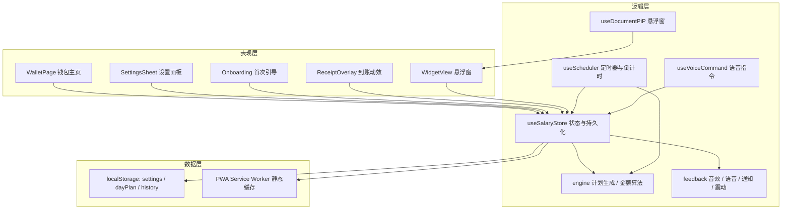

# 工资到账提示器 · 技术架构文档

## 1. 架构设计

纯前端、无后端、离线优先。所有配置与流水保存在 localStorage，跨窗口（主窗口 / PiP 悬浮窗）通过 React 状态共享（同源 Portal）与 `storage` 事件同步。



## 2. 技术说明

- 前端：React@18 + TypeScript + Vite + Tailwind CSS@3
- 初始化：Vite（react-ts 模板）
- 图标：lucide-react
- 字体：`@fontsource-variable/outfit`、`@fontsource-variable/manrope`（本地打包，离线可用）
- PWA：`vite-plugin-pwa`（autoUpdate + 离线缓存 + manifest）
- 状态：React Context + `useReducer` + 自定义 hook，无额外状态库
- 后端：无
- 数据库：localStorage（结构化 JSON，带版本号便于迁移）
- 部署：纯静态资源，任意静态托管；本地 `npm run dev` / `npm run preview`

## 3. 路由定义

| 路由 | 用途 |
|------|------|
| `/` | 钱包主页（含引导、设置、到账动效、PiP 悬浮窗入口） |

单页应用，所有视图以覆盖层与抽屉呈现，不额外拆路由，保证 PWA 离线与状态连续性。

## 4. 数据模型

### 4.1 类型定义

```ts
type UnitConfig = {
  label: string;                 // 元 / 查克拉 / 画饼
  symbol: string;                // ¥ / $ / ✦
  symbolPosition: 'prefix' | 'suffix';
  decimals: 0 | 2;
};

type PaceConfig = {
  mode: 'scheduled' | 'anytime'; // 定时：仅工作时段；随时：全天
  dailyCount: number;            // 1-20
  workStart: string;             // '09:00'
  workEnd: string;               // '18:00'
  weekdays: number[];            // 0=周日 ... 6=周六
  dndEnabled: boolean;           // 夜间免打扰（随时模式）
  dndStart: string;              // '23:00'
  dndEnd: string;                // '07:00'
  split: 'average' | 'random';   // 每次金额：平均 / 随机
  volatility: number;            // 0.2 - 0.8 随机波动强度
};

type AlertConfig = {
  bubble: boolean;
  sound: boolean;
  voice: boolean;
  systemNotification: boolean;
  vibration: boolean;
};

type TriggerConfig = {
  hotkey: boolean;
  voiceCommand: boolean;
  wakeLock: boolean;             // 桌面/安卓保持屏幕常亮
};

type Settings = {
  version: 1;
  monthlyGoal: number;
  unit: UnitConfig;
  pace: PaceConfig;
  alerts: AlertConfig;
  triggers: TriggerConfig;
};

type Receipt = {
  id: string;
  at: number;                    // 时间戳
  amount: number;
  source: 'auto' | 'manual' | 'catchup';
  slotIndex?: number;
};

type PlanSlot = {
  at: number;
  amount: number;
  status: 'pending' | 'done' | 'skipped';
  source?: Receipt['source'];
};

type DayPlan = {
  date: string;                  // YYYY-MM-DD
  dailyTarget: number;
  slots: PlanSlot[];
};
```

### 4.2 存储键

| Key | 内容 | 说明 |
|-----|------|------|
| `pda.settings.v1` | Settings | 首次引导完成后写入 |
| `pda.plan.v1` | DayPlan | 当日计划；跨日自动重建 |
| `pda.history.v1` | Receipt[] | 最多 200 条，按时间倒序 |

### 4.3 核心算法

**每月工作日与每日目标**：按 `weekdays` 统计当月工作日数 `workdays`，`dailyTarget = monthlyGoal / workdays`。

**计划时刻生成**（以日期字符串 + 设置哈希做种子，使用 mulberry32 伪随机，保证刷新后计划稳定）：

1. 构建合法时间窗：`scheduled` 模式为工作时段；`anytime` 模式为全天扣除免打扰时段（跨零点拆分为两段）。
2. 将时间窗总长等分为 N 个槽，第 i 笔落点 = 槽起点 + 槽长 × (0.15 + 0.7 × rand)，避免贴边与聚集。
3. 若当前时间已晚于某槽落点，且应用当日首次生成计划，则该槽标记 `skipped`（不补发），避免打开应用瞬间连弹。

**金额分配**：

- 平均：`base = dailyTarget / N`，前 N-1 笔按小数位四舍五入，最后一笔取余数保证合计等于 `dailyTarget`。
- 随机：为每笔生成 `w_i ∈ [1 - volatility, 1 + volatility]`，`amount_i = dailyTarget × w_i / Σw`，最后一笔取余数修正误差。
- 主动收款：优先取下一个 `pending` 槽的额度并置为 `done`（"提前领取"）；若当日无剩余槽，则按 `dailyTarget / N`（随机模式再乘波动）生成加餐额度。

**定时调度**：`setInterval(1000)` 每秒检查 `Date.now()`；命中 `pending` 且 `at <= now` 的槽位即触发（同一次 tick 内最多触发一笔，其余标记 `skipped` 防止堆积）。页面从 `visibilitychange` 恢复可见时立即校准一次。倒计时 = 下一个 `pending` 槽时间 − 现在。

**跨日与跨月**：每次 tick 检查 `date` 与 `month`，变化时重建计划；本月统计从 `history` 中按当前自然月聚合，无需单独计数。

### 4.4 反馈能力实现

| 能力 | 实现 |
|------|------|
| 收款音效 | Web Audio API 合成：1318.5Hz + 1975.5Hz 正弦波快速衰减叠加短促噪声，模拟"叮"；首次用户手势后创建 AudioContext |
| 语音播报 | `speechSynthesis`，优先选择 `zh-CN` 语音，文案 `到账 {金额}{单位}`，rate 1.05 |
| 系统通知 | Notification API，首次开启时请求权限；标题"到账提醒"，正文 `¥88.00 · 查克拉` |
| 通知横幅 | 应用内 React 组件，纯 CSS 动画，与系统通知独立 |
| 震动 | `navigator.vibrate([18, 40, 24])` |
| 屏幕常亮 | Screen Wake Lock API，在设置中开关，页面恢复可见时重新申请 |
| 悬浮窗 | Document Picture-in-Picture API：`requestWindow({ width: 320, height: 240 })`，将自包含的 WidgetView 通过 `createPortal` 渲染到 PiP document，并注入内联样式；不支持时隐藏入口 |
| 语音指令 | `webkitSpeechRecognition`（zh-CN，continuous，interimResults），命中关键词"到账 / 钱来 / 加钱 / 收钱"触发，2s 防抖；不支持时开关置灰 |
| 键盘快捷键 | Space / Enter 触发（输入框聚焦时忽略） |

## 5. 目录结构

```
PayDayAlert/
├── .trae/documents/            # PRD 与技术架构
├── public/icons/               # PWA 图标（192/512/maskable）
├── src/
│   ├── components/             # 页面与组件
│   │   ├── WalletPage.tsx
│   │   ├── BalanceCard.tsx
│   │   ├── TodayTimeline.tsx
│   │   ├── WeeklyChart.tsx
│   │   ├── ReceiptList.tsx
│   │   ├── ReceiptOverlay.tsx
│   │   ├── SettingsSheet.tsx
│   │   ├── Onboarding.tsx
│   │   └── WidgetView.tsx
│   ├── hooks/
│   │   ├── useSalaryStore.tsx
│   │   ├── useScheduler.ts
│   │   ├── useDocumentPiP.ts
│   │   ├── useVoiceCommand.ts
│   │   └── useCountUp.ts
│   ├── lib/
│   │   ├── types.ts
│   │   ├── defaults.ts
│   │   ├── storage.ts
│   │   ├── engine.ts
│   │   ├── feedback.ts
│   │   ├── phrases.ts
│   │   └── format.ts
│   ├── App.tsx
│   ├── main.tsx
│   └── index.css
├── index.html
├── tailwind.config.js
├── vite.config.ts
└── package.json
```

## 6. 非功能性要求

- 首屏 < 1.5s（本地资源、无网络请求）；字体使用 `font-display: swap`。
- 所有设置即时保存并立即重算当日剩余计划，无需手动"保存"（面板内改动即时生效）。
- 无障碍：按钮具备 `aria-label`，表单有 label 关联，动效尊重 `prefers-reduced-motion`。
- 兼容：Chrome/Edge 90+、Safari 15+、Android Chrome；对不支持的 API 做特性检测与降级提示。
- 隐私：不采集任何数据，不上传金额与单位。
